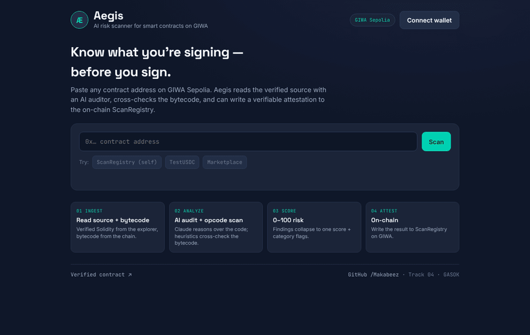

<div align="center">



### **AI risk scores for every smart contract on GIWA — written on-chain, readable by any wallet or dApp.**

[](https://www.aegisgiwa.com)
[](https://report.aegisgiwa.com)
[](https://sepolia-explorer.giwa.io/address/0x6C831F9d7051E94589807D2C3d924bb195b5de94)
[](LICENSE)
[](https://giwa.io)


</div>

> **Live proof, checkable on the GIWA explorer.**
> **23,291** unique GIWA contracts scored on-chain · **98%** of newly verified contracts scored within ~1 hour (206 of 211 in a 24-hour window, Nov 16–17) · **1,782** scores corrected on-chain after our own accuracy audit (Nov 17–18). Every number above is a transaction on [ScanRegistry](https://sepolia-explorer.giwa.io/address/0x6C831F9d7051E94589807D2C3d924bb195b5de94?tab=txs).

<div align="center">

</div>

---

## Why

Users can't tell a safe contract from a rug at the moment they sign. Audits are PDFs nobody reads, and scanners wait for someone to submit a contract.

Aegis flips that:

- **Proactive.** A watcher scores every newly verified GIWA contract automatically. No one has to ask.
- **On-chain.** Scores live in a verified registry contract. Any smart contract can call `riskOf()`; any site can embed a one-line badge.
- **Readable.** Claude reads the verified Solidity for logic flaws that bytecode tools structurally can't see; static analysis cross-checks the bytecode. Every finding is tagged with its source.
- **Auditable.** The model reports findings and severities; **code** computes the score from a published rubric.

When GIWA brings Upbit-scale users on-chain, the risk check has to be there on day one.

## Architecture

```
                      ┌─ Vercel ───────────────────────────────────────────────────────┐
Browser / wallet  --> │ index.html  ---->  /api/analyze                                │
Launchpad / dApp  --> │                     |- eth_getCode (GIWA RPC)                  │
 badge       --> │ /api/badge  <--+    |- static opcode walk (metadata-safe)      │
                      │ /api/stats  <--+    |- verified source (GIWA Blockscout)       │
                      │                |    |- Claude audit -> findings + severities   │
                      │                |    |- deterministic rubric -> 0-100 + flags   │
                      │                |    '- Dojang: is the deployer Upbit-verified? │
                      └────────────────────────────────────────────────────────────────┘
                                       | reads
                                       v
                      ┌─ GIWA Sepolia (chainId 91342) ─────────────────────────────────┐
                      │ ScanRegistry  0x6C831F9d7051E94589807D2C3d924bb195b5de94       │
                      │ attestBatch() - riskOf() - isFlagged() - getAttestation()      │
                      └────────────────────────────────────────────────────────────────┘
                                                     ^
                                                     | attestBatch() every hour
                                     ┌─ aegis-watcher (PM2) ────────────┐
                                     │ new verified contracts           │
                                     │   -> /api/analyze                │  github.com/Makabeez/aegis-watcher
                                     │   -> attestBatch (20 per tx)     │
                                     │ bytecode-hash dedupe             │
                                     └──────────────────────────────────┘
```

## Tech stack

| Layer | Tech |
|---|---|
| Contract | Solidity 0.8.30 · `ScanRegistry` · verified on GIWA Blockscout |
| AI audit | Anthropic Messages API · `claude-sonnet-4-6` · temperature 0 |
| Static analysis | Opcode walk over runtime bytecode (skips PUSH data and the CBOR metadata trailer) |
| API | Vercel Node serverless functions, zero dependencies |
| Identity | GIWA Dojang (EAS) — `DojangScroll.isVerified(deployer, UPBIT_KOREA)` |
| Automation | [`aegis-watcher`](https://github.com/Makabeez/aegis-watcher) — PM2, ethers v6, hourly `attestBatch` |
| Frontend | Single-file HTML, ethers v6 (`BrowserProvider`) for optional wallet attestations |

## Flow

1. **Ingest** — `eth_getCode` for the address; verified source + compiler from GIWA Blockscout.
2. **Static pass** — opcode walk flags DELEGATECALL, SELFDESTRUCT, approval interfaces, external calls.
3. **AI pass** — Claude reviews the verified Solidity and returns findings with a category, a severity and an explanation.
4. **Score** — `score = 6 + top severity + 0.35 × remaining severities`, capped 0–100, with weights `low 2 · medium 8 · high 20 · critical 45`. Categories collapse into a flags bitmap.
5. **Context** — GIWA Dojang check: is the deployer an Upbit-verified address?
6. **Attest** — the watcher writes `score, flags, keccak256(report), schemaVersion` to ScanRegistry in batches of 20.

## Smart contract

`contracts/ScanRegistry.sol` — byte-identical to the [verified source](https://sepolia-explorer.giwa.io/address/0x6C831F9d7051E94589807D2C3d924bb195b5de94?tab=contract). Pure storage + events: holds no ETH, makes no external calls.

```solidity
struct Attestation {
    uint8   riskScore;     // 0-100
    uint16  flags;         // OR of the FLAG_* bits detected
    bytes32 reportHash;    // keccak256 of the full off-chain report
    uint64  timestamp;
    address attester;
    uint32  schemaVersion;
}

function riskOf(address target) external view returns (uint8);
function isFlagged(address target, uint16 flag) external view returns (bool);
function getAttestation(address target) external view returns (Attestation memory);
```

| Flag | Bit | Value |
|---|---|---|
| `FLAG_REENTRANCY` | 0 | 1 |
| `FLAG_ACCESS_CONTROL` | 1 | 2 |
| `FLAG_DANGEROUS_APPROVAL` | 2 | 4 |
| `FLAG_HONEYPOT_RUG` | 3 | 8 |
| `FLAG_ORACLE_MANIPULATION` | 4 | 16 |
| `FLAG_UNSAFE_UPGRADE` | 5 | 32 |

**Gate anything on it in one line:**

```solidity
interface IScanRegistry {
    function hasAttestation(address) external view returns (bool);
    function riskOf(address) external view returns (uint8);
}

IScanRegistry aegis = IScanRegistry(0x6C831F9d7051E94589807D2C3d924bb195b5de94);
// riskOf() returns 0 for a contract that was never scored, so check hasAttestation() first:
// an unscanned contract must not pass as "safest".
require(aegis.hasAttestation(token) && aegis.riskOf(token) < 50, "Aegis: unscanned or high-risk token");
```

## API

| Endpoint | Returns |
|---|---|
| `GET /api/analyze?address=0x…` | `score`, `flags`, `flagList`, `findings[] {category, severity, title, explanation, source}`, `summary`, `engine`, `dojang`, `scoring`, `report` |
| `GET /api/badge?address=0x…` | SVG badge rendered **from on-chain data only** (✓ when the deployer is Upbit-verified via Dojang) |
| `GET /api/stats` | `totalAttestations`, registry, engine |

Public scans are rate-limited (`RL_PER_MIN`, default 8/min per IP; `RL_DAILY_MAX`, default 500 AI calls/day). The watcher bypasses them with a shared `AEGIS_INTERNAL_KEY` header.

**Embed a badge:**

```html

```

## Accuracy — what we found and fixed

We hand-check the engine and publish what we find.

- **Nov 17–18 — static false positive, fixed on-chain.** The opcode walk was reading the Solidity metadata hash at the end of the bytecode as code; a stray `0xf4` / `0xff` byte became a fake DELEGATECALL / SELFDESTRUCT finding. It affected **1,782 of 23,278 scored contracts (7.7%)**, which collapsed to 109 unique bytecodes. We fixed the walk ([`api/analyze.js`](api/analyze.js)), rescored each bytecode once, and rewrote the scores on-chain as `schemaVersion 4`. Rule applied: a correction may only lower a score. Contracts wrongly shown at 50+ risk: **355 → 1**.
- **Known limitations (open):**
  - Factory contracts embed child bytecode; its metadata can still trip the static walk. Fix: full disassembly with code/data separation.
  - The AI judges a contract in isolation: it can miss that an owner is a timelock, and it can flag correct code. Hand-checked findings only go into outreach; a public 100-contract labeled benchmark is a Phase 4 commitment.
  - AI severities can vary between runs on the same code. The watcher caches one score per bytecode; the public API will too.

## Local development

```bash
npm i -g vercel           # or: npx vercel@latest
cp .env.example .env      # fill in ANTHROPIC_API_KEY (+ workspace id if scoped)
vercel dev                # http://localhost:3000
```

No build step and no dependencies: `index.html` is static and each file in `api/` is a standalone serverless function.

## Deployment

```bash
vercel --prod
```

Set the variables from `.env.example` in **Vercel → Settings → Environment Variables** (they bind at build time, so redeploy after changing them). Never commit real values. `.env*` is git-ignored.

To run your own registry: deploy `contracts/ScanRegistry.sol` (solc 0.8.30, optimizer off, default EVM version — matches the verified build), then `setAttester(<watcher address>, true)` from the owner.

## Related

- **[aegis-watcher](https://github.com/Makabeez/aegis-watcher)** — the autonomous scanner that keeps the registry current.
- **[Phase 3 report & Phase 4 plan](https://report.aegisgiwa.com)** — results, milestones, KPIs.

## Attribution

Built by **Joe** ([@GeiserJoe2](https://x.com/GeiserJoe2) · [Makabeez](https://github.com/Makabeez)) for the **GIWA GASOK** program. GIWA Dojang identity checks use GIWA's public `DojangScroll` contract. AI audit by Anthropic Claude.

## License

[MIT](LICENSE)
